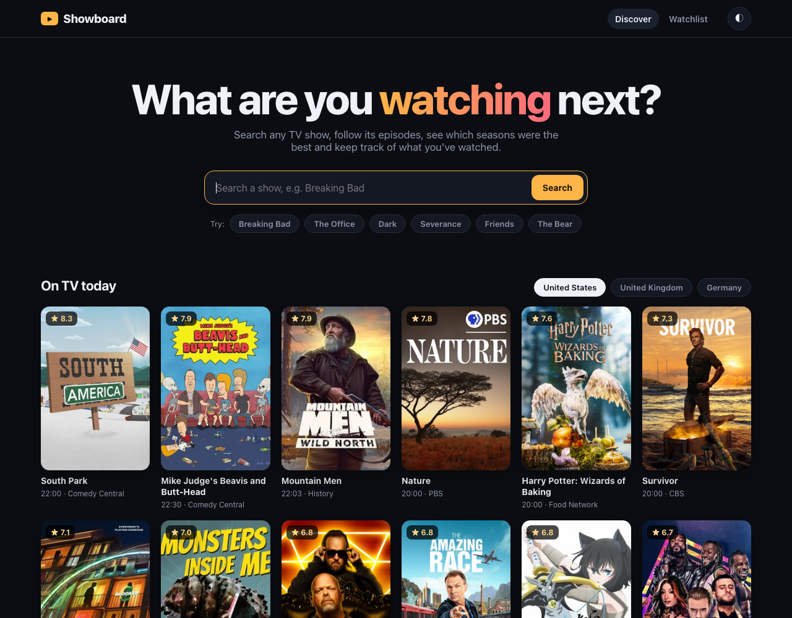
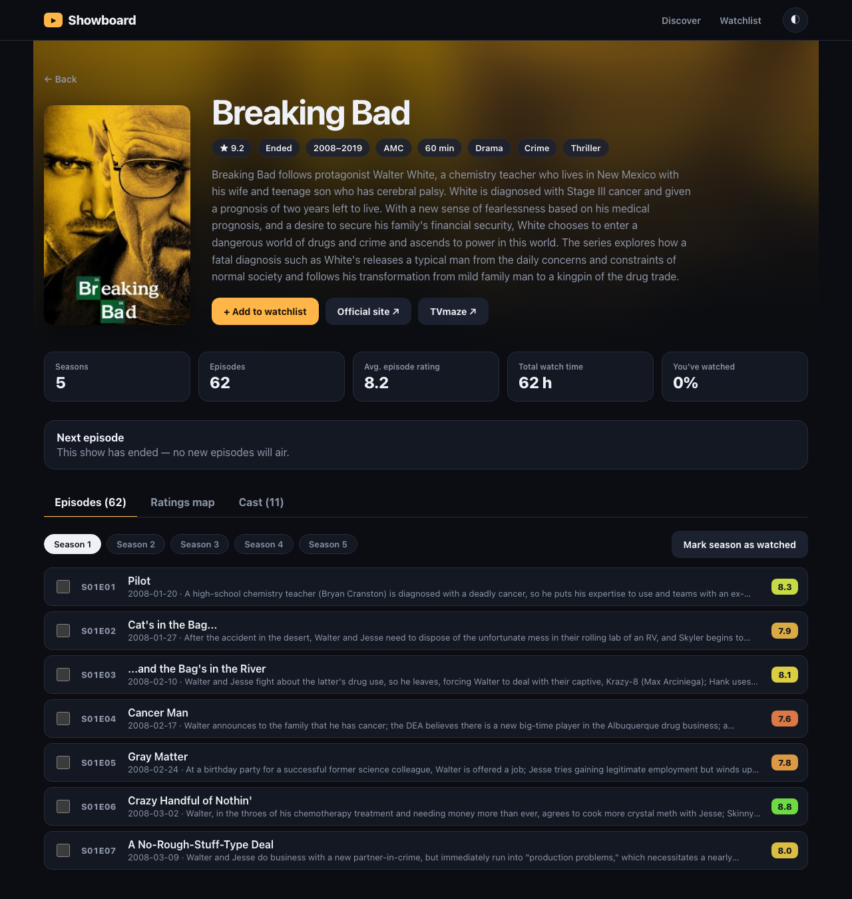
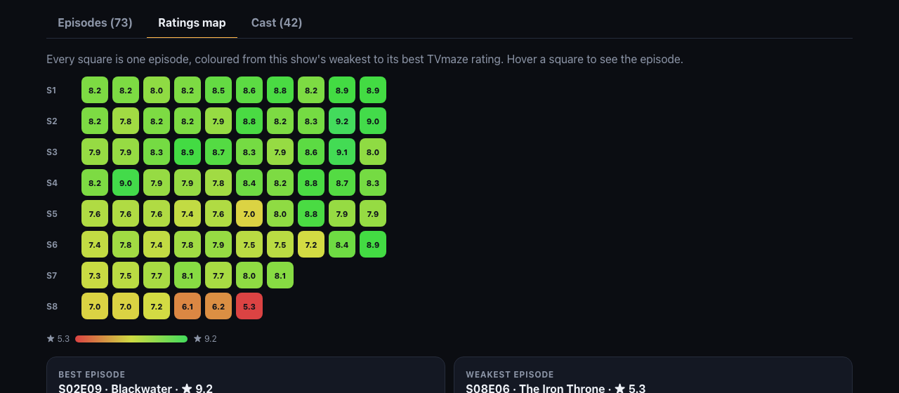

# Showboard: a TV show explorer on the TVmaze API

A small web app that connects to the public [TVmaze API](https://www.tvmaze.com/api). You can discover what's on TV today, search any show, browse its episodes, cast and a colour-coded ratings map, and keep a personal watchlist with the episodes you've already seen.



**Contents:**
[Purpose](#purpose) · [Data collection](#data-collection) · [Data persistence](#data-persistence) · [User interaction](#user-interaction) · [Setup](#setup) · [Learning](#learning) · [Limitations and assistance](#limitations-and-assistance) · [Audit](AUDIT.md)

## Purpose

This project is the *TVmaze API* assignment: build a solution that connects to and uses the API. Showboard is a single-page website written in plain HTML, CSS and JavaScript, with no framework, no build step and no API key. It turns the raw API data into something useful:

- **Discover:** the best-rated shows airing **today** in the US, the UK or Germany
- **Search:** find any show by name
- **Show page:** poster, summary, key facts, statistics, the next episode with a countdown, every episode by season, and the cast with photos
- **Ratings map:** a heatmap of every episode's rating, so you can see at a glance which seasons were strong and where a show dropped off
- **Watchlist and progress:** save shows and tick off watched episodes; the progress bar and the "You've watched" percentage update immediately



### Project structure

| File | Purpose |
|---|---|
| `index.html` | Page skeleton: top bar, main area, footer |
| `styles.css` | Design: dark and light theme, layout, responsive rules for phones |
| `app.js` | All logic: API calls, routing, views, watchlist storage |
| `docs/` | Screenshots used in this README |
| `AUDIT.md` | Publication audit: what was checked, found and fixed |
| `LICENSE` | MIT licence for the code |

## Data collection

**Source:** the [TVmaze REST API](https://www.tvmaze.com/api) at `https://api.tvmaze.com`. It is free and needs no account or API key. It also allows requests straight from the browser (CORS), so no backend server is needed.

**How the data is obtained:** `app.js` calls the API with `fetch()` and reads the JSON answers. Three endpoints are used:

| Endpoint | Used for |
|---|---|
| `GET /schedule?country=US` (or `GB`, `DE`) | Episodes airing today in a country (home page) |
| `GET /search/shows?q=NAME` | Shows matching a search term |
| `GET /shows/ID?embed[]=episodes&embed[]=cast&embed[]=nextepisode` | One show **plus** all its episodes, its cast and its next episode, in a single request (show page) |

Details worth knowing:

- **Embedding:** TVmaze can "embed" related data. Instead of four separate requests for a show page (show, episodes, cast, next episode), one request with `embed[]` returns everything. That makes the page faster and keeps the app far away from the rate limit.
- **Rate limit:** TVmaze allows about 20 requests per 10 seconds. If it answers `429 Too Many Requests`, the app waits a moment and retries up to three times.
- **Caching:** answers are kept in memory for the current visit, so going back to a page doesn't call the API again.
- **Safety:** show and episode summaries arrive as HTML. The app converts them to plain text and builds every element with `textContent`, so nothing from the API is ever inserted as HTML (this prevents script injection).
- **Attribution:** TVmaze data is licensed under [CC BY-SA 4.0](https://creativecommons.org/licenses/by-sa/4.0/); the footer credits TVmaze as the licence requires.

## Data persistence

**What is stored:** only your own watchlist and your watched episodes, plus your light/dark preference.

**Where:** in your browser's `localStorage`, under two keys:

| Key | Content |
|---|---|
| `showboard.v1` | `{ list: { showId: { name, image, status, episodes, addedAt } }, watched: { showId: [episodeIds] } }` |
| `showboard.theme` | `"light"` or `"dark"` (only if you used the toggle) |

**Why this way:**

- **No account and no server:** no account, server or database is needed, and the data never leaves your computer.
- **Lightweight:** the show data itself is *not* stored, because it can always be loaded fresh from TVmaze. Only what TVmaze can't know (your choices) is saved.
- **Small summary per show:** the watchlist keeps a name, a poster and the episode count, so the watchlist page can draw its cards and progress bars without calling the API for every show.
- **Kept in sync:** if the app is open in two tabs, a change in one tab updates the watchlist counter in the other (`storage` event).

The data stays in this one browser. It isn't synced to other devices, and clearing your browser data deletes it.

## User interaction

1. **Open the app** (see [Setup](#setup)). The home page shows today's best-rated shows; switch the country with the buttons on the right.
2. **Search:** type a show name and press Enter, or click a suggestion such as *Breaking Bad*.
3. **Open a show** by clicking its poster. On the show page you can:
   - press **+ Add to watchlist** to save it,
   - choose a **season** and tick episodes as watched, or use **Mark season as watched**,
   - switch to **Ratings map** and hover over a square to see the episode name and rating,
   - switch to **Cast** to see the actors and their characters,
   - open the official site or the TVmaze page.
4. **Watchlist:** the **Watchlist** link in the top bar shows all saved shows with a green progress bar. The home page also shows them under *Continue watching*.
5. **Theme:** the ◐ button switches between dark and light mode.

Every view has its own address, so you can bookmark or share it. For example, `#show/82/ratings` opens the ratings map of *Game of Thrones*:



Errors are shown clearly: a show that doesn't exist, a search without results, or a network problem each display a message instead of an empty page.

## Setup

**Requirements:** a modern browser (Chrome, Edge, Firefox or Safari) and an internet connection. Nothing needs to be installed and no configuration or API key is needed.

**Option A: just open it**

1. Download this repository: green **Code** button → **Download ZIP**, then unzip it. Or copy the address shown under **Code** and clone it with `git clone` followed by that address.
2. Double-click `index.html`. It opens in your browser and works right away.

**Option B: run a small local server** (optional, closer to a real website). In a terminal inside the project folder:

```bash
python3 -m http.server 8000
```

Then open <http://localhost:8000>.

**Option C: GitHub Pages.** Because it's a static site, it can be published for free: repository **Settings → Pages → Deploy from a branch → `main` / root**.

## Learning

**What I learned:**

- **REST APIs in practice:** reading API documentation, building request URLs, and turning JSON into a user interface with `fetch()` and `async`/`await`.
- **Fewer requests with embedding:** TVmaze's `embed[]` parameter combines related data into one answer, so a show page needs one request instead of four.
- **Single-page app basics:** the part of the address after `#` decides which view is shown (`#search/…`, `#show/…`, `#watchlist`). That gives working back buttons and shareable links without any framework.
- **Storing state in the browser:** `localStorage` holds the watchlist; each read and write is wrapped in `try/catch`, because storage can be blocked in private mode.

**Challenges and how I approached them:**

1. **HTML inside the API data.** Summaries come as HTML (`<p><b>…</b></p>`). Inserting that directly with `innerHTML` would be a security risk, because anything inside it would run on the page. I parse it with `DOMParser`, keep only the text, and create all elements through a small helper function that only ever uses text nodes.
2. **The ratings map looked flat.** My first version coloured ratings on a fixed scale from 6 to 9.5, but most shows only vary by one or two points, so almost every square came out the same yellow-green. I changed the scale to stretch from each show's weakest to its best episode and show those two values in the legend. Now the drop in *Game of Thrones* season 8 jumps out.
3. **Rate limits and repeated requests.** Instead of making many requests, I used `embed[]`, cached answers in memory, and added a retry for HTTP 429.
4. **Testing details.** While testing in the browser I found three bugs and fixed them:
   - An empty watchlist printed the word "null" on the home page.
   - Dates appeared in German because the browser's language was used. They are now always English to match the rest of the app.
   - The browser kept serving the old JavaScript file from its cache. A hard reload showed my changes.

## Limitations and assistance

### Limitations / incomplete features

- **One browser only:** the watchlist is saved in this one browser. There is no account, no sync between devices and no export.
- **Today only:** the home page shows today's schedule for three countries; other dates and streaming-only schedules are not included.
- **Search finds shows only,** not actors. People are only shown in a show's cast.
- **Very long-running shows** (for example daily news shows with thousands of episodes) produce a very large episode list and ratings map.
- **Images from TVmaze:** posters and photos are loaded directly from TVmaze's image server. The screenshots in `docs/` contain those posters, which belong to their owners.
- **Online only:** without an internet connection only the page shell and the error message are shown.
- **No automated tests:** I tested by hand in Chrome on desktop and phone size, in light and dark mode, including a show that doesn't exist, a search without results and the watchlist across reloads.

### Assistance

- **AI tools:** [Claude Code](https://claude.com/claude-code) (Anthropic's AI coding assistant) was used throughout. It wrote most of the code from my requirements, ran it in a browser to test it, took the screenshots, wrote this documentation with me and ran the publication audit (see `AUDIT.md`). I reviewed and tested the result and can explain how it works.
- **Reference:** before starting I looked at an earlier simple TVmaze example (a search page with a cast list and an episode checklist) to see the scope of the assignment. Showboard's code, design and features (schedule, embedded single request, ratings map, watchlist with progress, routing) were written fresh for this project.
- **Documentation used:** the [TVmaze API documentation](https://www.tvmaze.com/api) and the MDN Web Docs for `fetch`, `localStorage` and `DOMParser`.
- **No external code or libraries** are used. Fonts are the system fonts, so the page loads nothing except the TVmaze data and images.

## License

Code: [MIT](LICENSE). Show data and images: TVmaze, [CC BY-SA 4.0](https://creativecommons.org/licenses/by-sa/4.0/).
